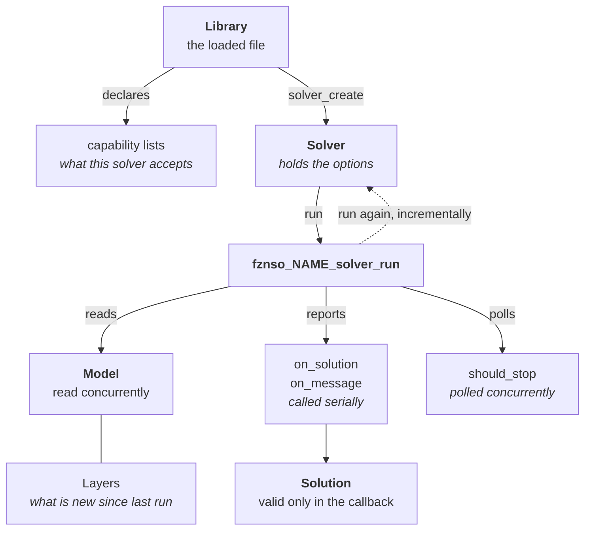

Six things make up the protocol.
Everything else is a detail of one of them.

## The objects

**Library** — a dynamically loadable file exporting the [thirteen entry points](../../spec/entry-points/).
Found by name, not by path.
Declares its capabilities through five lists; those answers are fixed for the life of the library.

**Solver** — an instance created from a library.
Holds options and whatever search state survives between runs.
Created, configured, run repeatedly, freed.

**Model** — the problem.
Not a structure you hand over, but [a table of callbacks](../../spec/model/) the solver reads through while it searches.
Read-only for the duration of a run.

**Value** — [anything that crosses the interface as data](../../spec/types-and-values/).
An opaque handle you interrogate for its kind and then read with the matching accessor.

**Solution** — an assignment to the decision variables, delivered to a callback.
Valid only for the duration of that callback.

**Layer** — a group of decisions and constraints added together, and retracted together.
What makes incremental solving possible; see [below](#incrementality).

## How they relate

The dashed edge is the one the protocol exists for: the same instance runs again against a changed
model, and [layers](../../spec/model/#layers) tell it which part of that model it has already seen.

## The shape of a session

1. **Find and open a library** by name.
   The loader [searches](../../spec/discovery/) a fixed list of directories and picks the newest matching version.
2. **Check the ABI version.**
   Before anything else. See [ABI stability](../../spec/abi-stability/).
3. **Read the capability lists** to learn what this solver accepts.
4. **Create a solver instance.**
5. **Set options** — a time limit, a thread count, a random seed.
6. **Run**, passing a model and callbacks.
   Solutions arrive at `on_solution`; diagnostics at `on_message`; the search stops when it is complete, or when `should_stop` says so.
7. **Inspect the status and statistics.**
8. **Change the model and run again.** This is the step the protocol exists for.
9. **Free the instance.**

Steps 5 to 8 repeat.
Steps 1 to 3 happen once per library.

## Incrementality

The reason for layers is step 8.
A layer groups decisions and constraints so they can be added and retracted together, and because indices follow layer order, nothing that survives a retraction is renumbered.
Before each run the model then tells the solver how much of the problem is unchanged, how much is committed for good, and how much has become vacuous — three numbers a solver may exploit or ignore, since re-reading everything is always correct.

The rules are in [The model](../../spec/model/#layers); the workflow in [Incremental solving](../../guides/incremental-solving/).

## Two rules to internalise early

Both cause most first-time bugs, and both are stated in full in [Lifetimes & ownership](../../spec/lifetimes-and-ownership/):
**nothing you receive is yours** — copy anything you want to keep — and **accessors have preconditions**, so ask a value its `kind` before reading it and check a length before using an index.
