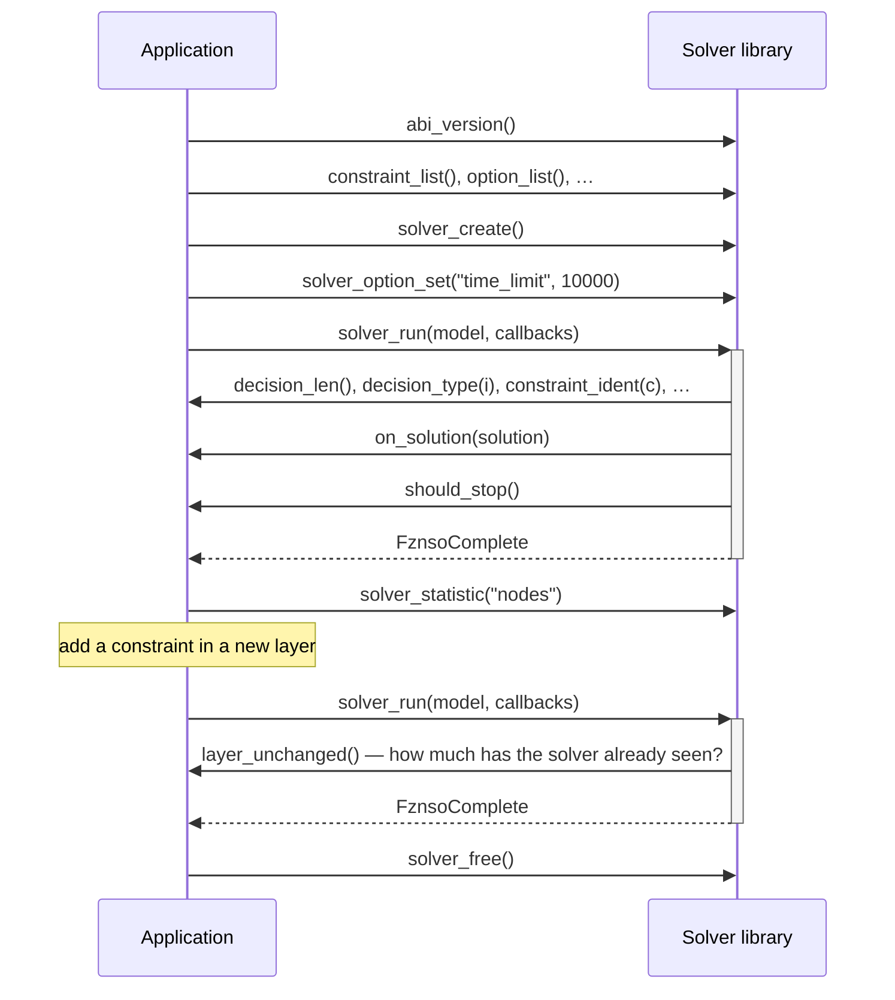

Six things make up the protocol.

**Library** — a dynamically loadable file exporting the [thirteen entry points](../../spec/entry-points/), found by name rather than by path.
Five [capability lists](../../spec/entry-points/#the-library) say what it accepts, and those answers are fixed for the life of the library.

**Solver** — an instance created from a library, holding options and whatever search state survives between runs.

**Model** — the problem, as [a table of callbacks](../../spec/model/) rather than a structure you hand over.
Read-only for the duration of a run.

**Value** — [anything that crosses the interface as data](../../spec/types-and-values/): a constraint argument, a domain, an option, a solution assignment.
An opaque handle you ask for its kind, then read with the matching accessor.

**Solution** — an assignment to the decision variables, delivered to a callback and valid only for its duration.

**Layer** — a group of decisions and constraints added together and retracted together.
See [Incrementality](#incrementality).

## A session

Open a library by name — the loader [searches](../../spec/discovery/) a fixed list of directories and picks the newest matching version — then [check its ABI version](../../spec/abi-stability/) before calling anything else.
From there, every arrow below is a call:

Control inverts inside `solver_run`: the solver pulls the model apart through callbacks, on however many threads it searches with, and pushes solutions and diagnostics back the same way.
Nothing is serialised and nothing is copied, so the application's own representation of the problem *is* the model.

## Incrementality

The second `solver_run` above is what the protocol exists for.
A layer groups decisions and constraints so they can be added and retracted together, and because indices follow layer order, popping a layer never renumbers what survives.

Before each run the model reports how many layers are unchanged since the last one, how many are committed for good, and how many have become vacuous.
A solver may exploit those three numbers or ignore them: re-reading everything is always correct.

The rules are in [The model](../../spec/model/#layers); the workflow in [Incremental solving](../../guides/incremental-solving/).

## Two rules

Both cause most first-time bugs, and both are stated in full in [Lifetimes & ownership](../../spec/lifetimes-and-ownership/):

- **Nothing you receive is yours.** Copy anything you want to keep.
- **Accessors have preconditions.** Ask a value its `kind` before reading it, and check a length before using an index.
